🌎 Select language / 选择语言 > US <a href="#">English</a> |
CN <a href="./README.zh-CN.md">中文</a>  

<h1>Oii, eu sou a Eve!</h1>

No momento me encontro realizando graduação, cursando Análise e Desenvolvimento de Sistemas. Sou Designer Gráfica quando estou disponível, e continuo aprimorando meus conhecimentos em TI.

## Linguagens com Experiência

  
  &nbsp
  &nbsp
  
  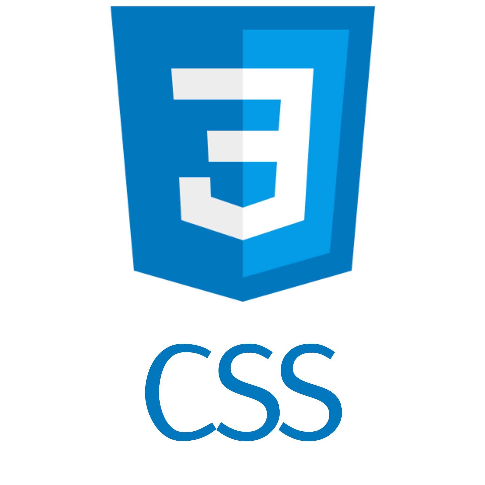

## Frameworks Integrados

  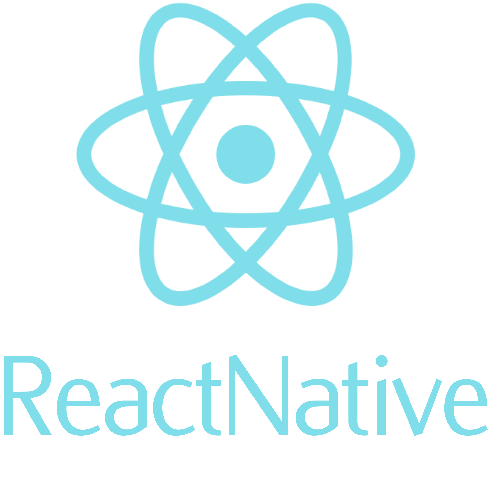 &nbsp
  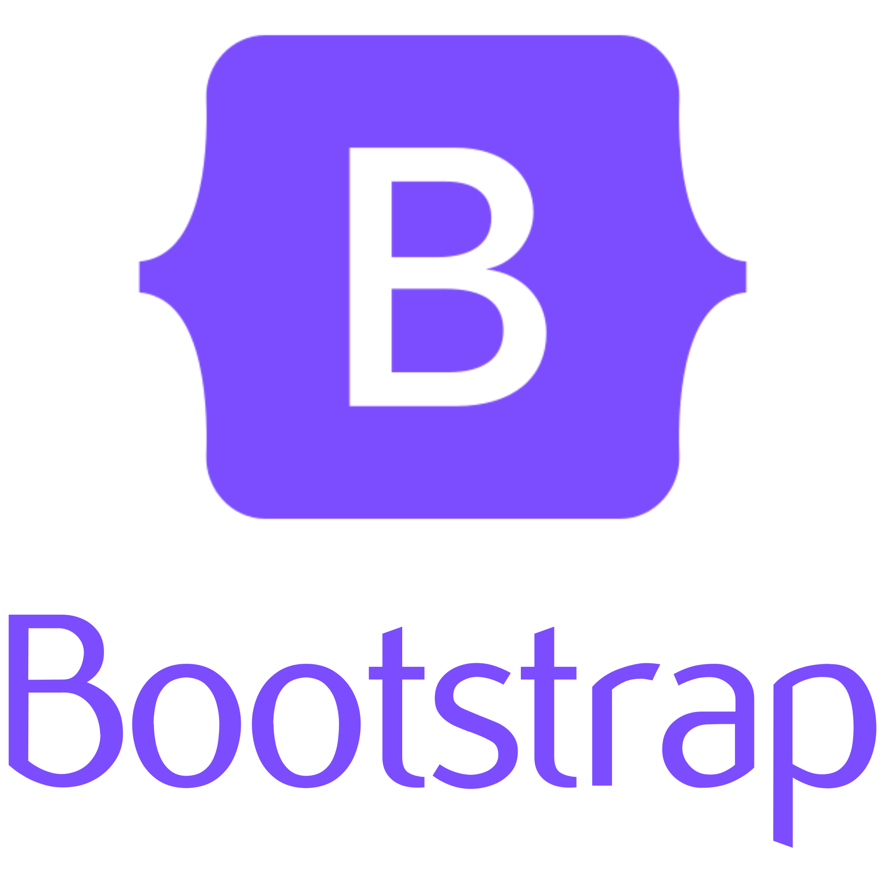

## Editores de código e IDEs

  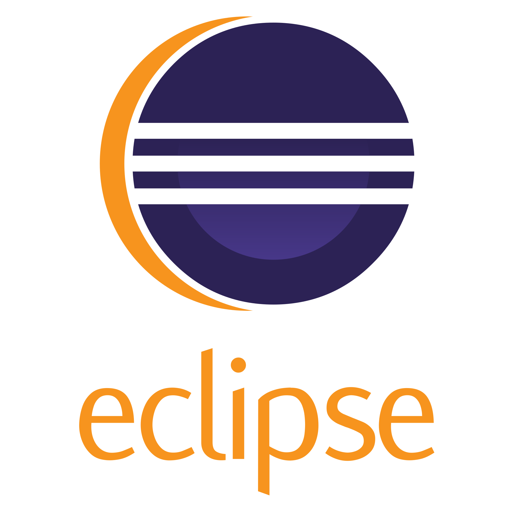
  

## Sistemas Operacionais(SO) Explorados

  
  

### Redes Sociais

  
  
  
   
  

  ### Pokémons Favoritos 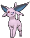
  

    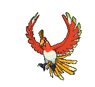
    &nbsp
    &nbsp
    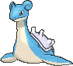&nbsp
    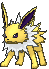
    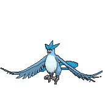
    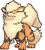&nbsp
    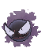
  

 

   

  

 
<a href="#">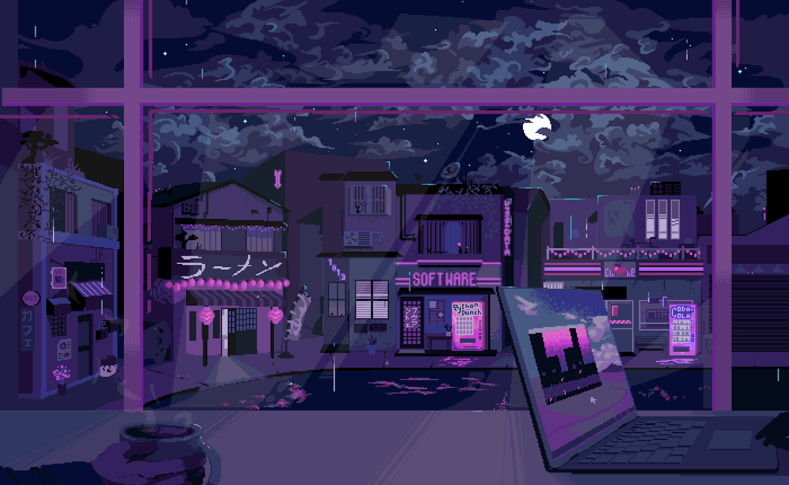</a>

## 

  

 

