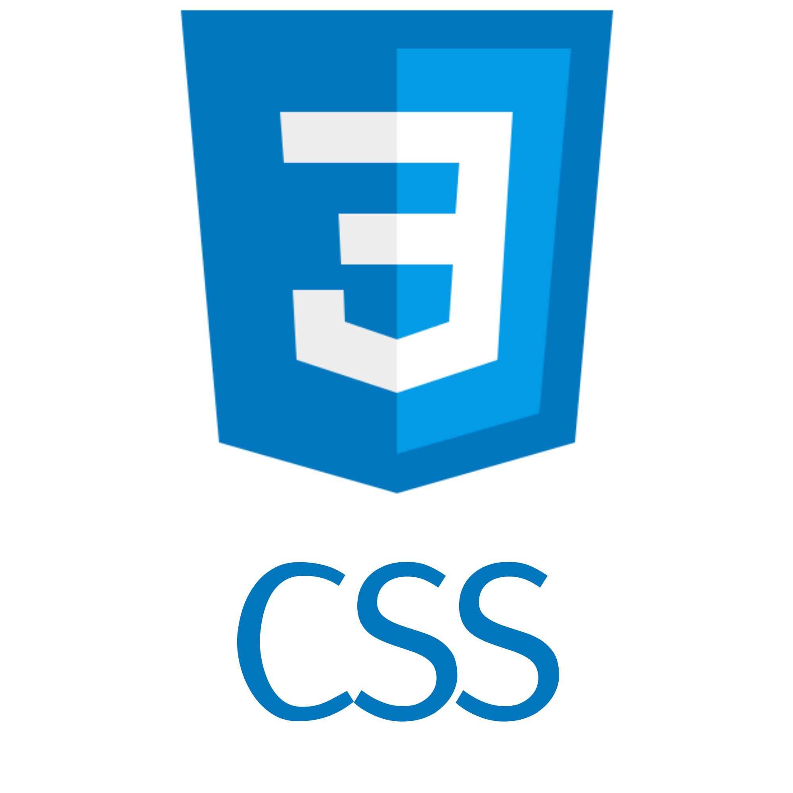
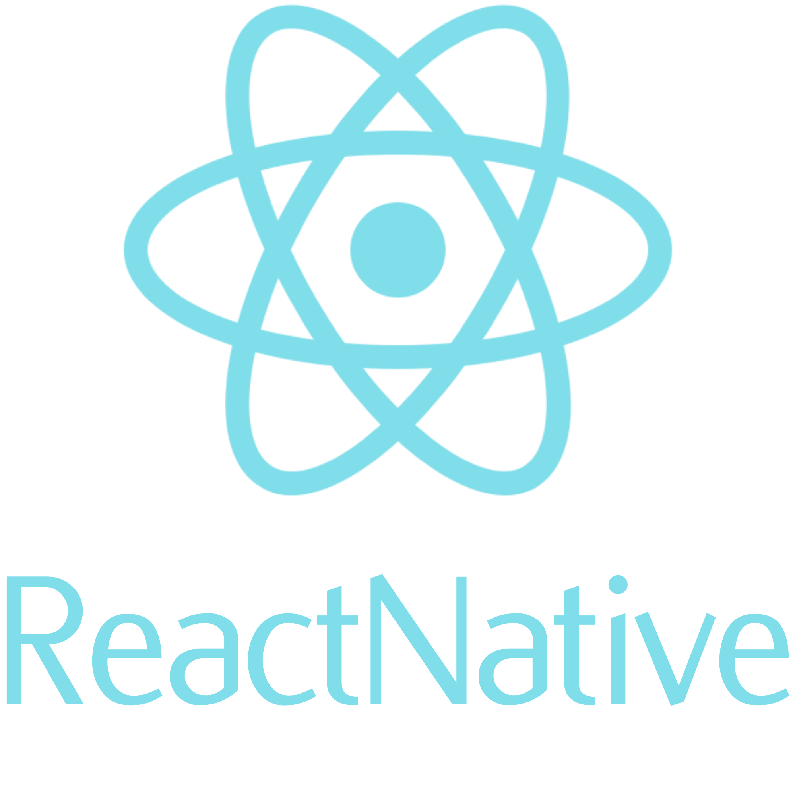
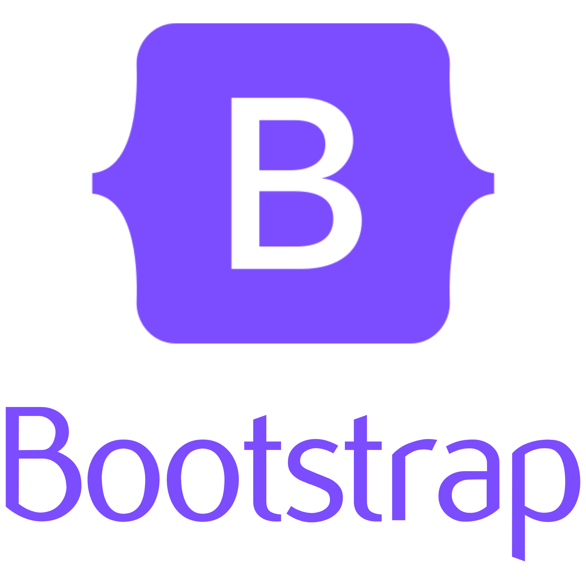
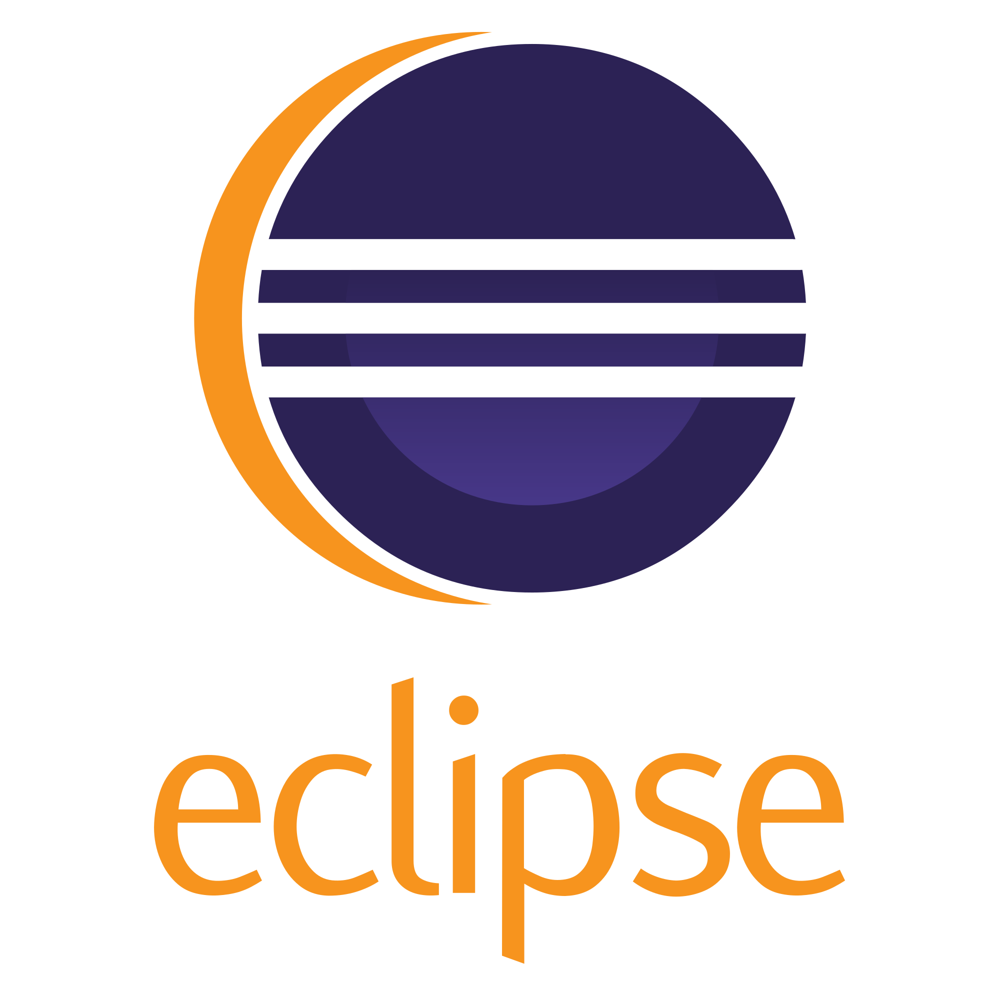
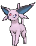
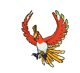
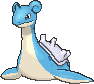
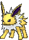
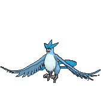
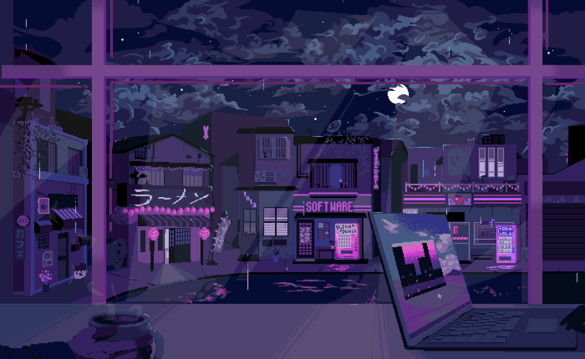

# 你好，我是 Eve！
目前我正在攻读系统分析与开发专业。
在空闲时间，我也从事平面设计工作，不断提升自己的创意与技术能力。

## 熟悉的编程语言

  
  &nbsp
  &nbsp
  
  

## 使用过的框架

   &nbsp
  

## 代码编辑器与 IDE

  
  

## 接触过的操作系统

  
  

### 社交媒体

  
  
  
   

### 最喜欢的宝可梦 
  

    
    &nbsp
    &nbsp
    &nbsp
    
    
    &nbsp
    
  

 

   

  

 

  

 

